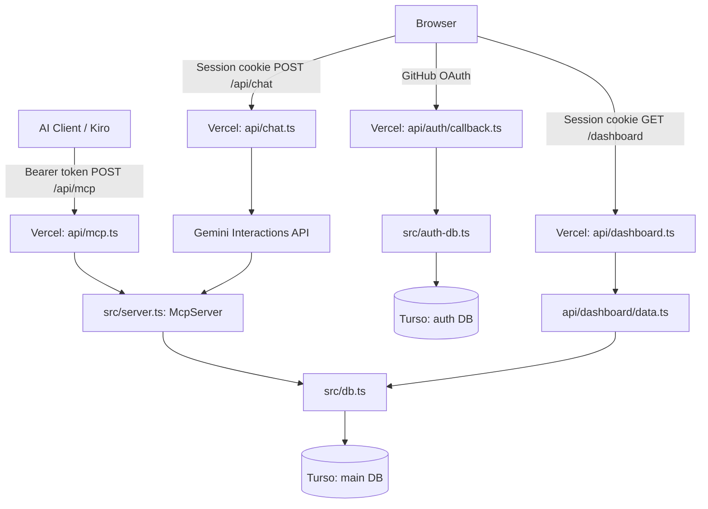

# Cortex

Cortex is a personal knowledge and productivity layer for AI clients. It exposes notes, tasks, and personal context via the Model Context Protocol (MCP), with per-user data isolation, GitHub OAuth, and a live Gemini-powered chat demo.

## Features

- **Notes** — Create, retrieve, update, and full-text search notes
- **Tasks** — Create, list, and update tasks with optional due dates and status tracking
- **Personal Context** — Store and retrieve key/value context pairs for the AI to reference
- **GitHub OAuth** — Secure sign-in; each user's data is fully isolated
- **Bearer token auth** — MCP clients authenticate with a personal token from the dashboard
- **Gemini chat demo** — Try the tools live from the landing page
- **Vercel + Turso** — Serverless deployment with a persistent LibSQL database

## MCP Tools

| Tool | Description | Required Parameters |
|------|-------------|--------------------|
| `create_note` | Create a note with title, content, and optional tags | `title`, `content` |
| `get_note` | Retrieve a note by ID | `id` (UUID) |
| `update_note` | Update a note's title, content, or tags | `id` (UUID) |
| `search_notes` | Full-text search across notes | `query` |
| `create_task` | Create a task with optional details and due date | `title` |
| `list_tasks` | List tasks, optionally filtered by status | — |
| `update_task` | Update a task's title, details, due date, or status | `id` (UUID) |
| `get_my_context` | Retrieve all personal context key/value pairs | — |
| `set_context` | Set a personal context key/value pair | `key`, `value` |

## Architecture



## Authentication

### GitHub OAuth (dashboard and chat)
Visiting `/api/auth/login` redirects to GitHub. After authorization, a session cookie is set and the user is sent to `/dashboard`. All dashboard and chat requests are authenticated via this session.

### Bearer token (MCP clients)
After signing in, generate your personal MCP token from the dashboard. Include it in every MCP request:
```
Authorization: Bearer <your-token>
```
Requests without a valid token receive `HTTP 401`. Token lookup is performed against the auth Turso database on every request.

### Per-user data isolation
Every DB query is scoped to `user_id`. A user can only read and write their own notes, tasks, and context. Cross-user access is not possible through the API.

### stdio mode (`STDIO_USER_ID`)
When running the server locally via stdio (e.g. in Kiro or Claude Desktop with a local `node` command), there is no HTTP auth. Data is stored under the value of `STDIO_USER_ID` (defaults to `"local"`). All stdio calls share this single bucket, so set a unique value if you need isolation.

## Dashboard

Sign in with GitHub to access your dashboard at `/dashboard`. From there you can:
- View and manage your notes, tasks, and context
- Generate or regenerate your MCP bearer token
- See usage statistics

## Setup

### Prerequisites
- Node.js 20+
- A [Turso](https://turso.tech) account (two databases: main data + auth)
- A GitHub OAuth app
- A [Vercel](https://vercel.com) account

### Local development
```bash
git clone https://github.com/omiii-legitt/cortex.git
cd cortex
npm install
cp .env.example .env
# Fill in .env with your credentials
npm run build
npm start  # stdio mode, or use Vercel CLI
```

### Environment variables

| Variable | Purpose | Required |
|----------|---------|----------|
| `TURSO_DATABASE_URL` | Main Turso database URL | Yes |
| `TURSO_AUTH_TOKEN` | Auth token for main Turso DB | Yes (remote) |
| `AUTH_DB_URL` | Auth Turso database URL | Yes |
| `AUTH_DB_TOKEN` | Auth token for auth Turso DB | Yes (remote) |
| `GITHUB_CLIENT_ID` | GitHub OAuth app client ID | Yes |
| `GITHUB_CLIENT_SECRET` | GitHub OAuth app client secret | Yes |
| `JWT_SECRET` | JWT signing secret (32-byte base64) | Yes |
| `GEMINI_API_KEY` | Gemini API key for chat endpoint | Yes |
| `STDIO_USER_ID` | User bucket for local stdio mode | No (default: `local`) |

### Deploy to Vercel
```bash
npm install -g vercel
vercel --prod
```
Set all environment variables in the Vercel dashboard under Project → Settings → Environment Variables.

## Connecting AI clients

Get your bearer token from the dashboard, then add this config to your client:

### Kiro
```json
{
  "mcpServers": {
    "cortex": {
      "url": "https://personal-mcp-server-taupe.vercel.app/api/mcp",
      "headers": { "Authorization": "Bearer YOUR_TOKEN" }
    }
  }
}
```

### Claude Desktop
```json
{
  "mcpServers": {
    "cortex": {
      "url": "https://personal-mcp-server-taupe.vercel.app/api/mcp",
      "headers": { "Authorization": "Bearer YOUR_TOKEN" }
    }
  }
}
```

### Cursor
```json
{
  "mcpServers": {
    "cortex": {
      "url": "https://personal-mcp-server-taupe.vercel.app/api/mcp",
      "headers": { "Authorization": "Bearer YOUR_TOKEN" }
    }
  }
}
```

### Windsurf
```json
{
  "mcpServers": {
    "cortex": {
      "url": "https://personal-mcp-server-taupe.vercel.app/api/mcp",
      "headers": { "Authorization": "Bearer YOUR_TOKEN" }
    }
  }
}
```

## Tests and CI

### Running tests
```bash
npm test              # run all tests once
npm run test:watch    # watch mode
npm run test:coverage # coverage report
```

Tests cover: db functions (notes, tasks, context, cross-user isolation), Zod input schemas (all 9 tools), rate-limiter logic, and MCP auth behavior (missing/invalid/valid token).

### CI badge
[](https://github.com/omiii-legitt/cortex/actions/workflows/ci.yml)

## Security

- **MCP endpoint** — Requires a valid `Authorization: Bearer <token>` header. Missing or invalid tokens receive `HTTP 401` with a `WWW-Authenticate` header.
- **Dashboard and chat** — Protected by GitHub OAuth session cookie.
- **Per-user isolation** — Every database query is scoped to the authenticated `user_id`. There is no shared data pool.
- **Secrets** — All secrets are stored in environment variables only. `.env.production` and `.env.local` are gitignored and never committed. `.env.example` contains only placeholder values.
- **Input validation** — All MCP tool inputs are validated with Zod schemas before reaching the database.
- **Rate limiting** — `/api/mcp` is limited to 60 requests/minute/IP; `/api/chat` to 20 requests/minute/IP.
- **Security headers** — `X-Content-Type-Options: nosniff`, `X-Frame-Options: DENY`, `Referrer-Policy: no-referrer` on all endpoints.

To report a vulnerability, see [SECURITY.md](./SECURITY.md).

## Limitations and Roadmap

### Current limitations
- **Rate limiter resets on cold start** — The rate limiter is in-memory. Each Vercel cold start resets the counters. It is best-effort, not a hard guarantee.
- **Anonymous chat data is not auto-cleaned** — Anonymous sessions get ephemeral per-session IDs, but the rows persist in Turso indefinitely (no TTL). This is low-impact since sessions are random and isolated.
- **stdio shares one bucket** — All local stdio calls share the `STDIO_USER_ID` bucket (default `"local"`). There is no per-process isolation.
- **GitHub OAuth only** — There is no password-based login.

### Roadmap
- Persistent rate limiting (Redis or Turso-backed)
- Test coverage expansion (e2e, auth flow)
- Multi-tenant MCP tokens (team/org support)
- v1.0.0 release tag
